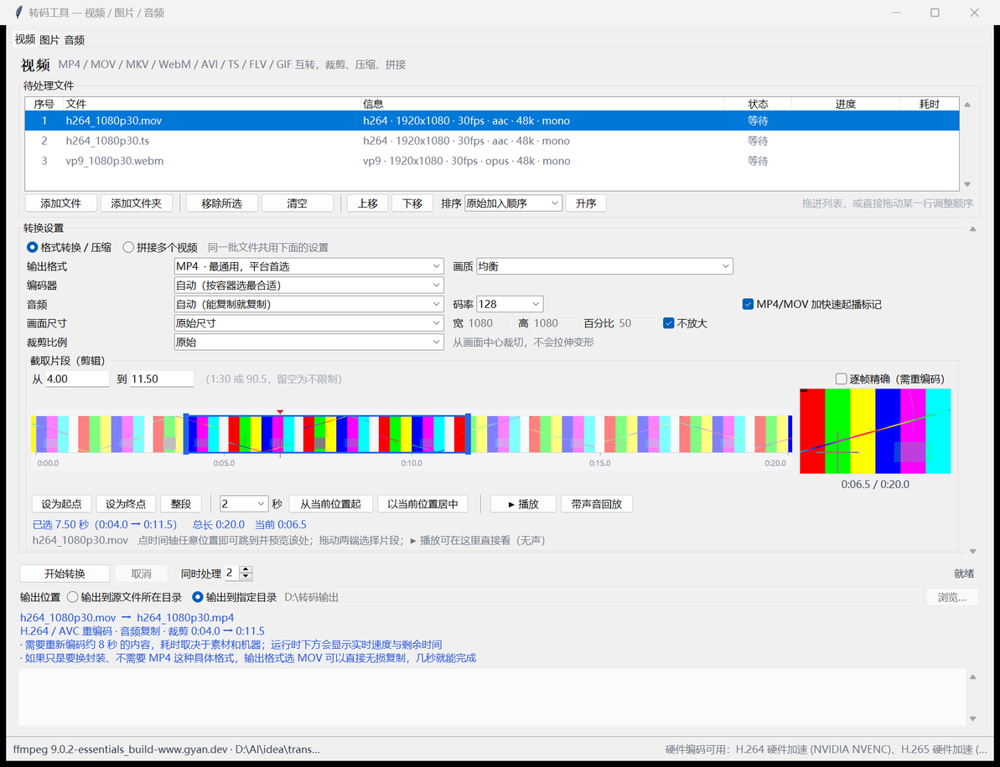
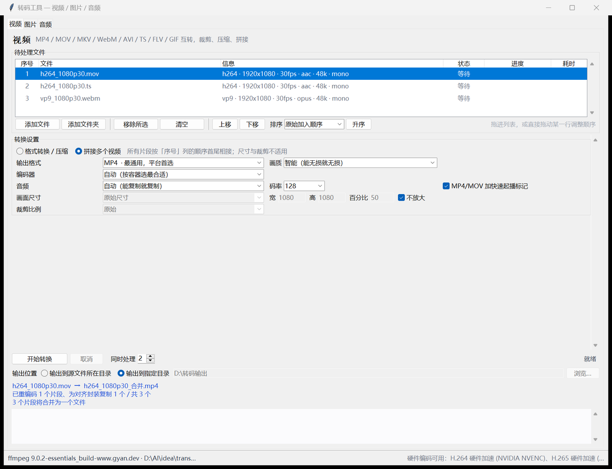
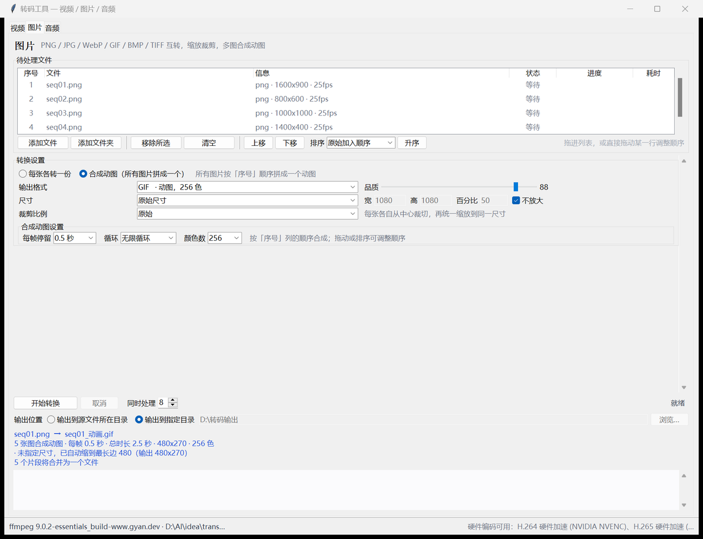
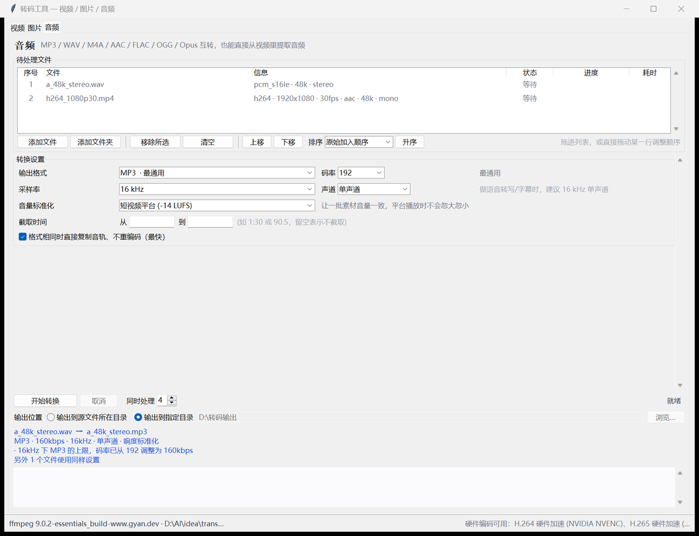

# 转码工具

给自媒体日常用的本地视频 / 图片 / 音频转码工具。原生 Windows 窗口，**不依赖浏览器、不依赖 Electron、不联网、不收集任何数据**，双击即用。

界面是 Tkinter，转码核心是 ffmpeg。所有尺寸、码率、滤镜参数在 Python 里算成确定的整数再交给 ffmpeg，所以**界面显示的输出跟真正产出的文件是一致的**。



---

## 目录

- [它解决什么问题](#它解决什么问题)
- [快速开始](#快速开始)
- [三块功能](#三块功能)
- [看得见画面地剪辑](#看得见画面地剪辑)
- [一些实测数据](#一些实测数据)
- [自检](#自检)
- [项目结构](#项目结构)
- [已知限制](#已知限制)
- [许可](#许可)

---

## 它解决什么问题

剪映、Premiere 都能转码，但这个工具针对的是"批量、明确、不损失"的日常动作：

| 你常做的事 | 这个工具怎么做 |
| --- | --- |
| 手机拍的 MOV 要进剪映 | H.264 画面直接流复制，只重编码必要的音轨，**几十毫秒**完成，画质零损失 |
| 十几段录屏要合成一条 | 自动统一分辨率/帧率/编码再拼；只差外壳的直接转封装，不重压一遍画面 |
| 一段录屏要剪出两秒做表情包 | 拖时间轴选区间，输出 GIF 自动限到 480px 并生成两遍调色板 |
| 一批素材音量忽大忽小 | 一键统一到抖音 -14 / 播客 -16 / 广播 -23 LUFS，实测误差 0.1 LU |
| 平台限制"必须小于 20MB" | 指定目标体积，两遍编码贴着目标走（实测目标 1MB 得到 0.94MB） |
| 一堆图要做成一张动图 | 按列表顺序合成一张 GIF / 动图 WebP，每帧停留精确到 0.05 秒 |

三块页面各管一件事，**只接受自己处理得了的类型**，放错会明确提示，不会默默转出奇怪的东西。

---

## 快速开始

### 方式一：用打包好的程序（不用装任何东西）

```
转码工具.exe        <- 双击这个，ffmpeg 已经打在里面
_internal\         <- 运行时（约 200MB）
```

整个文件夹拷到别的电脑就能用。首次启动约 4 秒（要做一次 ffmpeg 能力探测），之后 **0.7 秒**。

> 需要自己打包的话见 [build_exe.py](build_exe.py)：
> `python build_exe.py` 生成文件夹版（推荐），`--onefile` 生成单文件版（每次启动要解压 200MB，会慢十几秒）。

### 方式二：用源码运行

```bash
git clone https://github.com/JustinHan1021/transcode-tool.git
cd transcode-tool
python 转码工具.pyw          # 或者双击 启动.bat
```

需要 **Windows + Python 3.9 以上**。界面用 Python 自带的 tkinter，不需要 pip 安装任何依赖。

还要一份 **ffmpeg**（程序不随包，源码运行时需要自己准备）：

1. 从 <https://www.gyan.dev/ffmpeg/builds/> 下载 `ffmpeg-release-essentials.zip`（或 <https://github.com/BtbN/FFmpeg-Builds> 的完整版）
2. 解压后把 `ffmpeg.exe` 和 `ffprobe.exe` 一起放进本程序的 `bin\` 文件夹
3. 启动。界面右下角会显示识别到的版本

程序查找 ffmpeg 的顺序是：`手动指定` → `程序目录\bin\` → `PATH` → winget / chocolatey / scoop / `C:\ffmpeg` → 其它软件自带的（OBS、Blender、Tecplot 等）。找到后会把路径记在 `trans.config.json`，下次直接用。

> **一定把自己那份放进 `bin\`。** 最后那步兜底会整盘搜索其它软件自带的 ffmpeg，很容易翻出一个很旧的版本（实测在一台装了 Tecplot 的机器上找到的是 **4.3.1**）。旧版能转码，但**硬件编码调不通**（NVENC 接口与当前驱动不兼容）、**动画 WebP 只能输出不能输入**。程序的查找顺序是"先自己的 `bin\`，再整盘搜"，所以只要 `bin\` 里放了新版，就一定优先用新版。
>
> `ffmpeg.exe` 和 `ffprobe.exe` 请成对放置：两者来自不同构建时，读文件信息和转码可能得出不一致的结果。

`ffprobe` 严格来说是可选的：没有它程序会退回去解析 `ffmpeg -i` 的输出，功能不受影响。

可选：`pip install tkinterdnd2` 之后可以把文件**直接拖进窗口**；没装也不影响使用，用「添加文件」或把文件拖到 `启动.bat` 上一样可以导入。

---

## 三块功能

### 视频

| 能力 | 说明 |
| --- | --- |
| 格式互转 | MP4 / MOV / M4V / MKV / WebM / AVI / TS / FLV / GIF |
| 画质 | 智能 / 强制无损复制 / 高质量 / 均衡 / 小体积 / 极小体积 / **指定目标体积** |
| 编码器 | 自动 / H.264 / H.265 / VP9 / VP8 / MPEG-4，以及**实测可用**的硬件编码器 |
| 画面尺寸 | 按宽度 / 按高度 / 限制最长边 / 按百分比 / 限制在方框内 / 精确尺寸 |
| 裁剪比例 | 原始 / 1:1 / 4:3 / 3:4 / 16:9 / 9:16 / 3:2 / 2:3 / 2.35:1，从中心裁切不变形 |
| 音频 | 自动 / 强制复制 / 不要音频 / AAC / MP3 / Opus / FLAC / AC3 / PCM，可指定码率 |
| 拼接 | 切到「拼接多个视频」，列表顺序就是拼接顺序 |



**媒体池的顺序就是处理顺序**：最左边的「序号」列是拼接 / 合成的顺序。

- 直接拖动某一行就能调整位置，序号自动重排
- 「上移 / 下移」批量移动选中的行
- 「排序」可按文件名、类型、大小、时长、修改时间、原始加入顺序排，右边按钮切换升降序
- 文件名排序是**数字感知**的：`record (2)` 排在 `record (10)` 前面（普通字符串排序会反过来，录屏文件名最容易踩）

### 图片

输出 JPEG / PNG / WebP / BMP / TIFF / GIF。缩放与裁剪方式跟视频一致（先裁再缩，所以「裁 1:1 再缩到 800×800」能得到准确的 800×800）。

**「合成动图」模式把多张图拼成一张 GIF**，而不是一张图一个文件：



- 按「序号」列顺序逐帧播放，拖动或排序即可调整
- **每帧停留** 0.05 ~ 5 秒，GIF 延时精确（0.5 秒就是 0.5 秒，实测无漂移）
- 循环次数、颜色数可调；输出也可以是动图 WebP（体积更小）
- 尺寸按第一张图推算，未指定时自动缩到最长边 480px；**各张尺寸不一样也没关系**，每张各自裁切后统一缩放
- 单张转换时：透明 PNG 转 JPEG 会自动铺白底（不会变黑块）；手机照片读 EXIF 方向自动旋正；GIF / WebP 输入转同格式时保留动画

### 音频

输出 MP3 / M4A / WAV / AAC / FLAC / OGG / Opus。



- **从视频提取音频**：直接把视频加到音频页，程序自动跳过画面；格式相同时可无损复制音轨
- **语音转写 / 字幕**：采样率 16 kHz、单声道，配合剪映、Whisper 识别率明显更好
- **音量标准化**：一键统一到抖音/小红书 -14、播客 -16、广播 -23 LUFS
- **码率自动适配**：码率和采样率是两个独立下拉框，但编码器不是任意组合都接受（8 kHz 下 MP3 最高只有 64 kbps，Opus 每声道上限 256 kbps，libvorbis 在低采样率会直接拒绝编码）。程序会把码率调到上限并**在界面上说明调了什么**，而不是最后一秒失败

---

## 看得见画面地剪辑

视频页的「截取片段」把文件抽成一条**胶片条**，右边配**预览窗口**——不用开着原视频对照时间点。

- 点时间轴任意位置就跳到那里，右边立刻显示**那一帧**，下面标着 `3:09.3 / 6:18.5`
- 拖两端改起止，拖中间整体平移，选区外自动灰掉；拖动时预览跟着走
- 「从 / 到」输入框与时间轴**双向同步**：可以直接输入 `1:30`
- **▶ 播放**在窗口里直接播（无声，Tk 放不了音频）；「带声音回放」把选中段压成小片段交给系统播放器
- **快捷选取**：长度填 2、点「从当前位置起」，就是"从这里取两秒"

无损复制时切点会对齐到关键帧（快，但可能偏一点）；需要精确到帧就勾「逐帧精确」，程序会重编码那一段并提前告诉你画质会再压一次。

---

## 一些实测数据

以下都是在开发机上实测的数字，不是估算。素材是屏幕录制与合成测试片。

### 剪辑与换封装几乎不花时间

| 操作 | 实测耗时 |
| --- | --- |
| 截取 20 秒（无损） | **0.06 秒** |
| 整个 6:19 素材换成 MKV | **0.14 秒** |
| 整个 6:19 素材无损装进 MP4 | **0.10 秒** |

### GPU 到底有没有用

结论：**大多数活儿用不上，4K 重编码时才划算。** 换成新版 ffmpeg 之后 NVENC / AMF 都能被识别并实测通过（下拉框里会出现 5 项硬件加速），但：

| 素材 | 方式 | 耗时 | 体积 |
| --- | --- | --- | --- |
| 屏幕录制 2560x1154 → 720p，60 秒 | libx264 软编 | 1.26s | 194KB |
| 同上 | h264_nvenc | 1.91s | 257KB（+32%） |
| 同上 | hevc_nvenc | 1.67s | 290KB（+50%） |
| 4K30 高细节，20 秒（全分辨率） | libx264 软编 | 8.95s | 46.7MB |
| 同上 | h264_nvenc | 9.42s | **102.4MB（+119%）** |
| 同上 | **hevc_nvenc** | **6.10s（快 1.47 倍）** | 49.7MB（+7%） |

- **屏幕录制这类"好压"的素材**，软编能跑到 47 倍实时，GPU 帮不上，体积反而大 30–50%
- **4K、高细节**素材上 `H.265 NVENC` 是明确划算的：快 1.47 倍，体积只多 7%
- `h264_nvenc` 不建议用：4K 下体积翻倍还更慢

**硬件解码一律更慢，所以没有启用。** `-hwaccel cuda` / `d3d11va` 都能初始化，但实测解 60 秒素材：CPU 0.56 秒，cuda 1.71 秒。原因是这一代 ffmpeg 解完还要把画面拷回内存，多一次搬运。这也是为什么达芬奇快而 ffmpeg 快不了：达芬奇整条链路都在显存里，纯转码工具里 GPU 只在最后一步参与。

所以**默认走 CPU 软编**，但你可以在「编码器」下拉里手动选硬件编码。

### 性能是怎么省下来的

- **优先无损复制**：换封装不重编码，只搬数据
- **视频和音频分别决策**：已是 H.264 的素材转 MP4 时画面直接复制，只对音轨做必要处理
- **几何计算在 Python 里算好**：裁剪缩放的尺寸是精确整数，直接写进滤镜
- **不重复劳动**：两遍编码只在「指定目标体积」时用，且只为 x264/x265 启用
- **正确对待录屏的可变帧率**：Chrome 录屏的文件头把时基（1000/1）写成了帧率，照它走会把 8 秒素材变成 8000 帧、工作量放大几十倍。程序会丢掉这类不可信数值并要求 ffmpeg 透传原始时间戳
- **时长读不到就自己数**：Chrome 录制的 WebM 根本不写时长字段，程序用一次「只读不解码」的数包过程恢复（45MB 约 0.08 秒）
- **画面尺寸以实际解码为准**：这类录屏头部声明 2560x1238、实际是 2560x1154，按头部算会被纵向拉伸 6.8%
- **运行过程一直有反馈**：当前步骤、已完成百分比、实测速度（如 8.4x 实时）、预计剩余时间

#### 几个 ffmpeg 的坑（都踩过并修好了）

写在代码注释里，这里也留一份，因为它比功能表更能说明这个工具在哪些地方做了额外的事：

- **无损剪辑不能用 `-copyts`。** 加上之后 `-t` 会按原始时间轴计算：剪 1.0→2.5 只得到 0.53 秒，只给起点直接产出空文件。
- **拼接列表必须同族。** concat 解复用器要求所有条目编码参数、封装族、**时间基**三者一致，否则错得很难看：MP4 接 MKV 会得到只有一半时长、两段画面叠在一起的文件；MP4 接 TS（同为 H.264）会因为 1/90000 与 1/15360 的时间基差异把 40 秒变成 234 秒。程序会在开始前把不齐的片段补齐（只差外壳的走转封装复制，不重编码）。
- **GIF 两遍调色板的两种写法不能互换。** 生成调色板那遍的时长限制必须是**输入选项**（`-t` 放 `-i` 前），否则 palettegen 会解码整段；写 GIF 那遍必须是**输出选项**，且调色板要通过 `movie` 滤镜读入，不能当第二路输入。
- **不同版本 ffmpeg 对 EXIF 方向的处理不一样。** 旧版忽略方向标签、新版自己旋正，照着版本号猜会双重旋转。程序会**实际解一帧对比尺寸**来判断这份 ffmpeg 旋不旋。
- **动画 WebP 没有时长字段**，ffprobe 不给，不处理就会被当静帧转掉。

---

## 自检

`selftest/` 下是一整套可重复运行的自检。它们真的调用 ffmpeg、真的写文件、再逐项核对产出（编码、分辨率、时长、帧数、像素），而不是只看命令拼得对不对。

```bash
python selftest/corpus.py      # 先生成测试素材（约 400MB，落到 _corpus/）
python selftest/video.py       # 视频：格式×编码×画质×几何×音频×剪辑×目标体积（162 项）
python selftest/image.py       # 图片：格式×透明×EXIF×品质×动图×合成动图（86 项）
python selftest/audio.py       # 音频：格式×无损提取×采样率×响度×剪辑×提取（88 项）
python selftest/concat_matrix.py   # 容器两两混搭 + 三段混搭拼接（46 项）
python selftest/rate_matrix.py     # 格式×采样率×码率全部 864 种组合能否编码
python selftest/gui_run.py         # 真实窗口端到端：三万余种界面组合 + 导入路由 + 拖动排序 + 时间轴 + 取消 + 快捷键
python selftest/static.py          # 死代码扫描：未使用导入、没人调用的函数、重复定义
python selftest/frozen.py          # 打包产物：冷启动、内置 ffmpeg、真实转换
```

`selftest/corpus.py` 也接受一个素材目录作为参数（`python selftest/corpus.py D:\我的录屏`），把真实录屏纳入测试——合成素材编码太容易，会藏住真实素材才有的问题。

---

## 项目结构

```
转码工具.pyw          入口，双击启动（无控制台窗口）
启动.bat              用源码运行时的启动脚本，也支持拖放导入
build_exe.py          打包脚本，生成 dist\转码工具\
assets\app.ico        程序图标
trans/
  ff.py               ffmpeg 定位、能力探测、硬件编码器实测验证
  media.py            媒体信息探测（ffprobe 优先，缺失时解析 ffmpeg -i）
  exif.py             EXIF 方向读取（纯标准库，JPEG/TIFF）
  geometry.py         缩放/裁剪尺寸计算，保证与界面显示一致
  presets.py          容器、编码器、画质档位、码率钳制等参数表
  plan.py             把设置翻译成具体的 ffmpeg 命令
  engine.py           并发执行、进度解析、取消
  ui/                 界面：主窗口 + 视频/图片/音频三个标签页
selftest/             自检脚本（见上）
docs/screenshots/     README 用的截图
```

删除 `trans.config.json` 和 `.ffcache.json` 后重启，会重新做一次完整的 ffmpeg 探测，适合换过 ffmpeg 之后排查问题。

---

## 已知限制

- **只支持 Windows。** 界面是 Tkinter 可以跨平台，但窗口行为、拖放、`creationflags` 都按 Windows 写的。
- **Tk 放不了音频**，所以窗口内播放是无声的；要听声音请用「带声音回放」。
- **合成动图超过约 300 张图可能超命令行长度上限**，界面会给警告。
- **硬件编码器按"真实试编码"判断可用性**，所以某个驱动版本的 NVENC 调不通时，下拉框里就不会出现，而不是让你跑一遍才发现失败。
- 转码质量取决于 ffmpeg 构建：想用更新的编码器（AV1 软编等）换一份完整版构建放进 `bin\` 即可，不需要改代码。

---

## 许可

[MIT](LICENSE)。ffmpeg 本身是 LGPL/GPL，打包分发时请遵守其许可。
